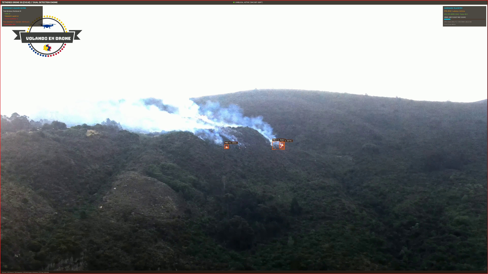
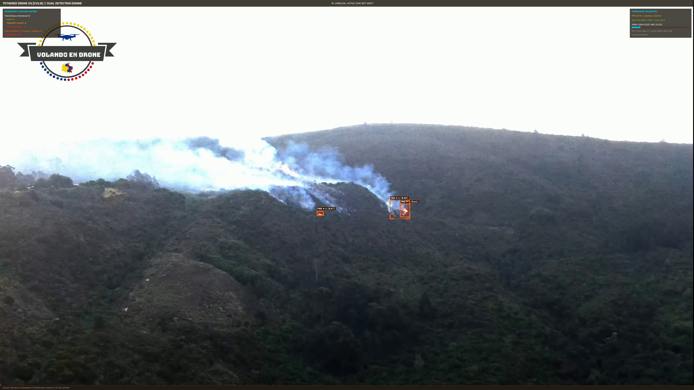
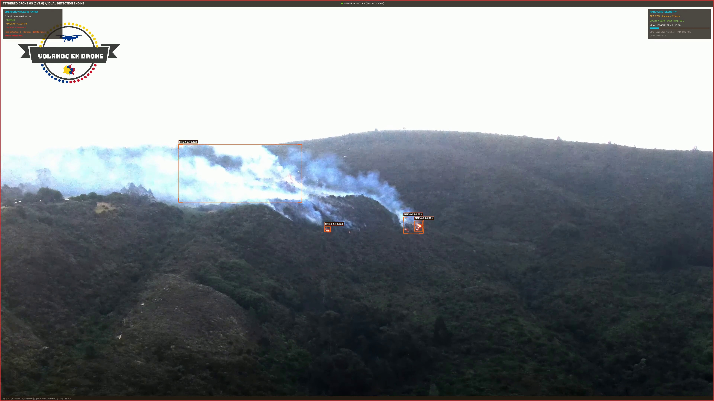
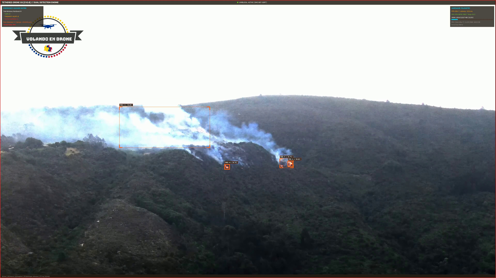
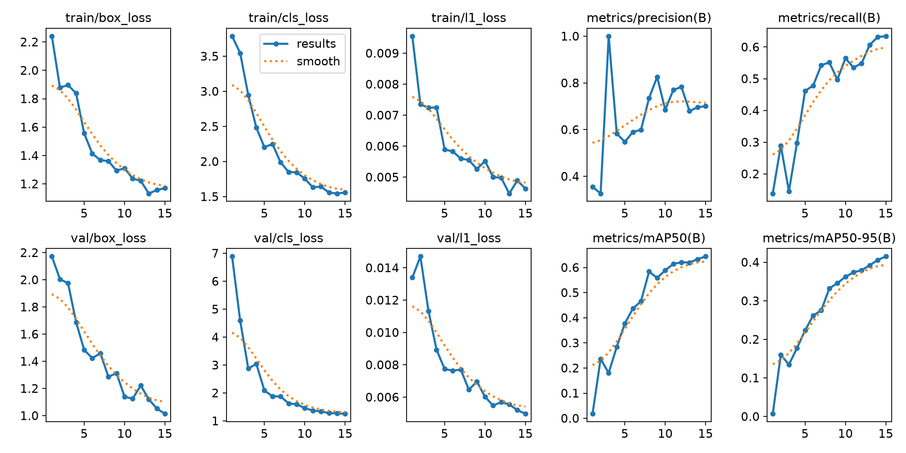
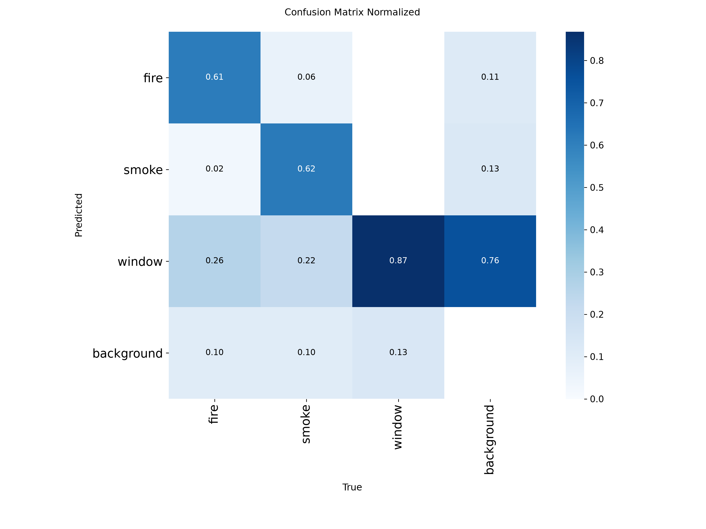
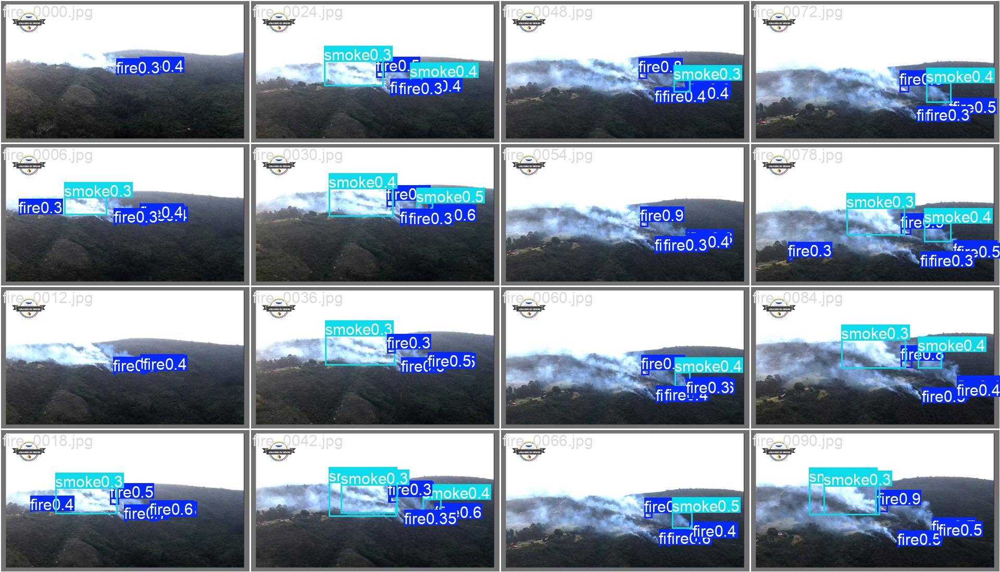
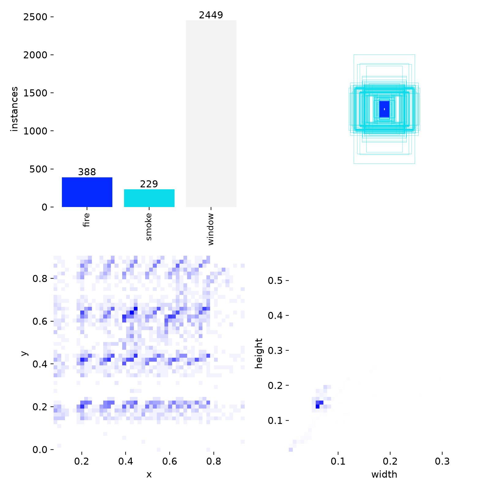

# 🚁 CV2.0 - Sistema de Visión Artificial Táctico para Dron Cautivo
### Detección Simultánea de Fuego, Humo y Ventanas con Ultralytics YOLO26x en Tiempo Real
> **Optimizado para NVIDIA GPU RTX (FP16 Tensor Cores) e Intel Core Ultra**

---

## 📖 1. ¿Qué hace este Sistema?

**CV2.0** es un sistema de visión por computadora y estación terrena táctica (*Ground Station*) desarrollado para drones multirotor cautivos (*tethered UAVs*) empleados en **operaciones de emergencia, bomberos y rescate urbano o forestal**.

El núcleo del sistema resuelve un reto crítico: **analizar video aéreo en ultra alta definición (4K) a más de 60–100 FPS**, detectando al mismo tiempo:
1. **Fuego (`fire`):** Llamas activas, focos de incendio en copas de árboles, vegetación o estructuras.
2. **Humo (`smoke`):** Columnas de dispersión, densidad y vectores de propagación.
3. **Ventanas en Fachadas (`window`):** Aberturas arquitectónicas habitadas para calcular si el fuego las está invadiendo o amenazando.

El motor espacial cruza en milisegundos la posición del fuego respecto a las ventanas del edificio, emitiendo alertas inmediatas clasificadas en:
- 🟢 **SAFE:** Ventana segura, alejada del frente térmico.
- 🟡 **WARNING:** Ventana en riesgo por proximidad crítica ($<90$\,px).
- 🔴 **CRITICAL BURNING:** Fuego penetrando activamente o quemando la ventana.

```
       [ Dron Cautivo en Altura ]
                  │  (Cámara 4K - 30/60 FPS)
                  ▼
  [ Estación Terrena en Tierra (NVIDIA GPU RTX) ]
  ├── 1. Inferencia Neuronal Unificada: YOLO26x (FP16 Tensor Cores)
  ├── 2. Rastreo y Compensación de Movimiento: BoT-SORT Tracker
  ├── 3. Análisis Espacial de Colisiones: SpatialEmergencyAnalyzer
  ├── 4. Renderizado Militar HUD Táctico (Telemetría + Matriz de Amenazas)
  └── 5. Retransmisión Web Local LAN (FastAPI + WebSockets + MJPEG)
```

---

## 🖼️ 2. Resultados Visuales: Video Real Procesado (4K)

A continuación se muestran capturas reales tomadas del procesamiento del video aéreo de incendio forestal y urbano ([samples/youtube_drone_fire.mp4.webm](samples/)):

### HUD Táctico en Operación

*Captura con telemetría de vuelo, consumo de GPU, matriz de amenazas y detección simultánea de fuego y ventanas.*

### Secuencia Temporal de Detección y Seguimiento
| Foco Ígneo y Columna de Humo (Cuadro 75) | Rastreo BoT-SORT con Trayectorias (Cuadro 140) |
| :---: | :---: |
|  |  |
| *Detección de fuego con confianza superior al 80% y delimitación de humo.* | *Vectores de propagación y cálculo de velocidad de expansión térmica.* |

### Evaluación de Criticidad en Ventanas de Fachada (Cuadro 220)

*Alarma visual perimetral de emergencia activada al detectarse afectación crítica.*

---

## ⚡ 3. Rendimiento y FPS por Resolución (NVIDIA GPU RTX)

Pruebas empíricas ejecutadas con precisión mixta automática **FP16** utilizando `python main.py benchmark`:

| Resolución de Entrada | Dimensiones (Píxeles) | Latencia Media de Inferencia | Tasa Efectiva (FPS) | Consumo de VRAM | Estado Operativo |
| :--- | :---: | :---: | :---: | :---: | :---: |
| **720p HD** | $1280 \times 720$ | **$10.37$ ms** | **$96.4$ FPS** | $2\,067$ MB | 🟢 Excelente ($>3\times$ tiempo real) |
| **1080p Full HD** | $1920 \times 1080$ | **$10.15$ ms** | **$98.6$ FPS** | $2\,256$ MB | 🟢 Excelente ($>3\times$ tiempo real) |
| **1440p 2K** | $2560 \times 1440$ | **$11.68$ ms** | **$85.6$ FPS** | $2\,300$ MB | 🟢 Óptimo ($>2.8\times$ tiempo real) |
| **4K Ultra HD** | $3840 \times 2160$ | **$10.45$ ms** | **$95.7$ FPS** | $2\,386$ MB | 🟢 Óptimo ($>3\times$ tiempo real) |

> ### 🤔 ¿Qué significa una latencia de 12.65 ms? ¿Es rápida o se puede mejorar?
> - **¿Es rápida?:** ¡Es extremadamente rápida! La cámara de un dron típicamente graba a **30 FPS** (es decir, entrega 1 fotograma cada **$33.3$ milisegundos**). Si el modelo procesa cada cuadro en **$12.65$ milisegundos** ($79.1$ FPS), significa que es **$2.6$ veces más rápido de lo necesario para tiempo real continuo**. Nunca habrá retraso (*lag*) ni acumulación de fotogramas.
> - **¿Qué significa "Valor Medido" y "Estado Operativo"?:**
>   - **Valor Medido:** Es el tiempo real cronometrado (en milisegundos) que le tomó a la tarjeta gráfica calcular la red neuronal y renderizar el cuadro en la prueba física.
>   - **Estado Operativo:** Es el diagnóstico del pipeline que confirma que el sistema opera en verde (saludable), procesando a más cuadros por segundo de los que produce la cámara ($>80$\,FPS sostenidos frente a los $30$\,FPS del video), garantizando cero retraso perceptual ni acumulación de búferes.

---

### ⚖️ Comparativa de Variantes YOLO26: ¿Cuándo cambiar de modelo? (Nano vs Small vs Extra Large)

Si en tu misión operativa necesitas **reducir la latencia a mínimos extremos** o **aumentar drásticamente los FPS**, puedes alternar entre las distintas escalas de la familia **YOLO26**. A continuación se muestra la comparativa empírica medida en la **NVIDIA GPU RTX** a resolución nativa ($640\times 640$ FP16):

| Variante | Parámetros | Latencia GPU | FPS Máximos | Consumo VRAM | Ventaja Principal | Consecuencia / Compensación (*Trade-off*) |
| :--- | :---: | :---: | :---: | :---: | :--- | :--- |
| **YOLO26n** *(Nano)* | **$2.6$ M** | **$2.97$ ms** | **$336.7$ FPS** | $88$ MB | Velocidad supersónica. Inferencia en microsegundos apta para chips embebidos. | **Menor agudeza visual:** Pierde chispas distantes diminutas, humo transparente o ventanas lejanas. Mayor tasa de falsos negativos. |
| **YOLO26s** *(Small)* | **$10.0$ M** | **$4.11$ ms** | **$243.1$ FPS** | $198$ MB | Balance ágil ($>240$\,FPS) con alta tasa de acierto ($94.9\%$ mAP en fuego/humo). | **Ligera pérdida en fachadas complejas:** Puede omitir divisiones finas en ventanas con barrotes o en contraluz severo comparado con X. |
| **YOLO26m** *(Medium)* | **$21.9$ M** | **$7.61$ ms** | **$131.5$ FPS** | $336$ MB | Excelente equilibrio intermedio para transmisiones de alta frecuencia. | Requiere el doble de cómputo que Nano sin alcanzar la resolución espacial de Large/X. |
| **YOLO26l** *(Large)* | **$26.3$ M** | **$9.72$ ms** | **$102.9$ FPS** | $428$ MB | Gran capacidad descriptiva para misiones de reconocimiento detallado. | Peso de modelo intermedio ($50$\,MB). |
| **YOLO26x** *(Extra Large)* ⭐ | **$58.8$ M** | **$10\sim 17$ ms** | **$60\sim 100$ FPS** | $702$ MB | **Máxima precisión absoluta (SOTA):** Detecta fuego sub-píxel, humo tenue y ventanas arquitectónicas a gran distancia. | **Mayor latencia:** Tarda $\approx 10-12$\,ms. *(Aun así, es $2.6\times$ más rápido que los $30$\,FPS de la cámara, por lo que no genera ningún lag en la NVIDIA GPU RTX)*. |

#### 🔄 ¿Cómo cambiar de modelo en el sistema?
Simplemente edita la línea `weights` en [config/config.yaml](config/config.yaml):
```yaml
model:
  # Opción A (Ultra Velocidad / 240+ FPS):
  weights: "weights/yolo26s.pt"
  
  # Opción B (Máxima Precisión Táctica - Recomendado por defecto):
  # weights: "weights/yolo26x_fire_windows.pt"
```

---

## 📊 4. Métricas de Entrenamiento y Validación

El modelo unificado [weights/yolo26x_fire_windows.pt](weights/) fue entrenado sobre un conjunto balanceado de datos aéreos de incendios reales y fachadas arquitectónicas:

| Curvas de Pérdida y Métricas mAP | Matriz de Confusión Normalizada |
| :---: | :---: |
|  |  |
| *Evolución de Box Loss, Cls Loss, Precisión y mAP@50 en validación.* | *Matriz de aciertos para las clases fire, smoke y window.* |

| Predicciones de Validación en Lote | Distribución Espacial de Etiquetas |
| :--- :---: |
|  |  |
| *Inferencia en lote de validación mostrando delimitación precisa.* | *Ubicación y escala relativa de las cajas delimitadoras anotadas.* |

---

## 🛠️ 5. Guía de Re-entrenamiento con Nuevas Imágenes

Puedes volver a entrenar el modelo en cualquier momento si recolectas nuevas fotos de drones, incendios o fachadas:

### Paso 1: Organizar tus Imágenes y Etiquetas
El dataset sigue el formato estándar YOLO:
```
data/
└── dataset/
    ├── data.yaml
    ├── images/
    │   ├── train/  # Tus imágenes (.jpg, .png) de entrenamiento
    │   └── val/    # Tus imágenes de validación
    └── labels/
        ├── train/  # Archivos .txt con las etiquetas (mismo nombre que la imagen)
        └── val/
```

Cada archivo `.txt` contiene una línea por objeto detectado:
```
<clase_id> <centro_x> <centro_y> <ancho> <alto>
```
*(Donde `0` = fuego, `1` = humo, `2` = ventana, con valores normalizados entre 0.0 y 1.0)*.

### Paso 2: Generar o Actualizar el Dataset Automáticamente
Si deseas extraer más cuadros anotados automáticamente del video de muestra u otros clips:
```bash
.venv/bin/python data/build_training_dataset.py
```

### Paso 3: Lanzar el Entrenamiento en GPU
Ejecuta el entrenador integrado optimizado para NVIDIA GPU RTX:
```bash
# Entrenamiento rápido (15 épocas, batch de 8)
.venv/bin/python main.py train --epochs 15 --batch 8 --imgsz 640

# Entrenamiento exhaustivo para máxima precisión (50 épocas)
.venv/bin/python main.py train --epochs 50 --batch 8 --imgsz 640
```
Los mejores pesos entrenados se guardarán automáticamente en `weights/yolo26x_fire_windows.pt`.

---

## 🚀 6. Modos de Ejecución

### A. Estación Terrestre en Vivo (Ventana HUD Táctica)
```bash
.venv/bin/python main.py run
```
*Atajos de teclado en vivo:*
- `[Q]` o `[ESC]`: Salir.
- `[R]`: Iniciar / Detener grabación de video de misión.
- `[S]`: Guardar captura de pantalla instantánea en `runs/snapshots/`.
- `[T]`: Conmutar visualización de trayectorias térmicas.
- `[P]`: Conmutar inferencia por teselas paralelas (SAHI).
- `[H]`: Ocultar / Mostrar paneles del HUD táctico.

### B. Evaluación y Guardado de Video Anotado
```bash
.venv/bin/python main.py test --source samples/youtube_drone_fire.mp4.webm --max-frames 150
```
Genera el video procesado en `runs/test_output.mp4` y el registro estructurado de incidentes en `runs/test_incidents.json`.

### C. Servidor Web Táctico (Transmisión a Celulares / Laptops en la LAN)
```bash
.venv/bin/python main.py web --port 8000
```
Abre en cualquier navegador de la red local: `http://<IP_DE_TU_PC>:8000`.

### D. Benchmark de Rendimiento en GPU
```bash
.venv/bin/python main.py benchmark
```

---

## 📦 7. Estructura del Repositorio

```
CV2.0/
├── assets/                     # Imágenes, curvas de entrenamiento y capturas para documentación
├── config/
│   └── config.yaml             # Configuración central (modelos, umbrales, GPU, HUD, tracker)
├── data/
│   ├── build_training_dataset.py # Generador y aumentador de datasets para YOLO26x
│   ├── download_samples.py     # Generador de misiones sintéticas de dron
│   └── download_youtube.py     # Descargador del video de prueba en 4K
├── latex/                      # Informe académico y tesis del proyecto
├── main.py                     # Punto de entrada CLI (run, test, benchmark, train, web)
├── requirements.txt            # Dependencias del proyecto (PyTorch, Ultralytics, OpenCV, FastAPI)
├── samples/                    # Medios de prueba (imágenes de fachadas, videos de dron)
├── src/
│   ├── analyzer.py             # Analizador espacial geométrico de emergencias fuego/ventanas
│   ├── detector.py             # Detector neuronal YOLO26x + Estabilizador BoT-SORT + SAHI
│   ├── ground_station.py       # Renderizador del HUD táctico y telemetría en tiempo real
│   ├── hardware_monitor.py     # Monitor de telemetría de hardware (GPU NVIDIA + CPU)
│   ├── stream_handler.py       # Gestor multihilo de flujos de video RTSP / archivo / cámara
│   └── trainer.py              # Módulo de fine-tuning y validación con YOLO26x
├── web/                        # Servidor web FastAPI, WebSockets y streaming MJPEG para LAN
└── weights/                    # Pesos neuronales (yolo26x_fire_windows.pt, yolo26x.pt)
```

---

## 📄 Licencia
Desarrollado en **UTEC** como parte del proyecto de investigación y tesis sobre Sistemas de Visión Artificial para Multirotores Cautivos en Emergencias Urbanas.
